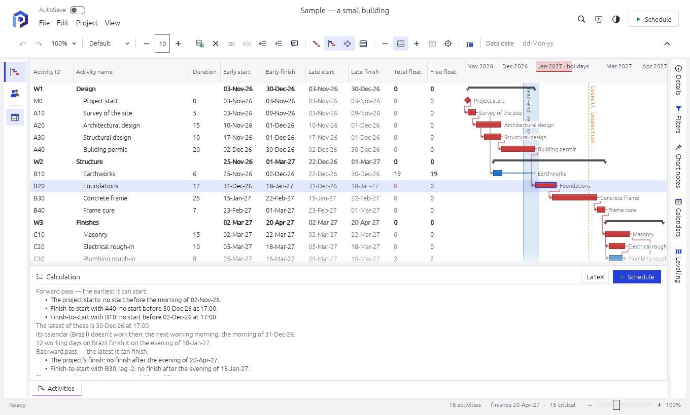
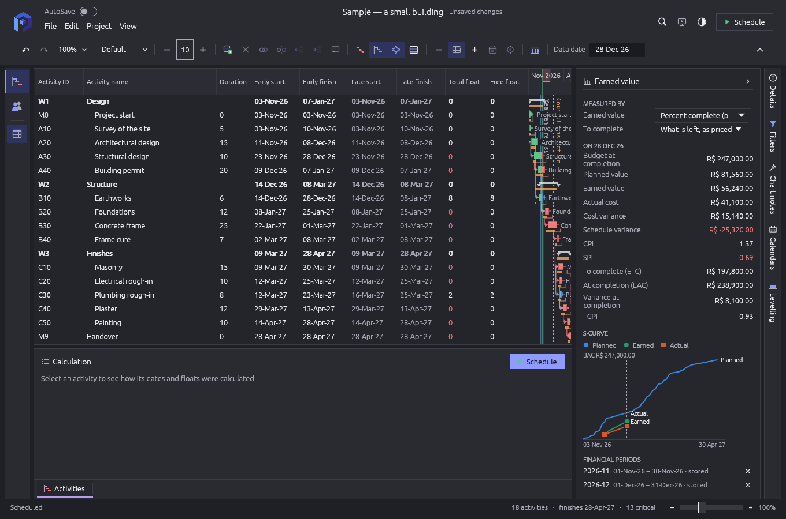
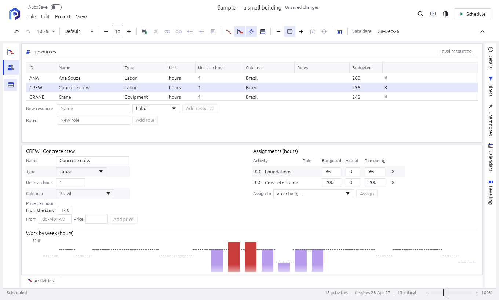
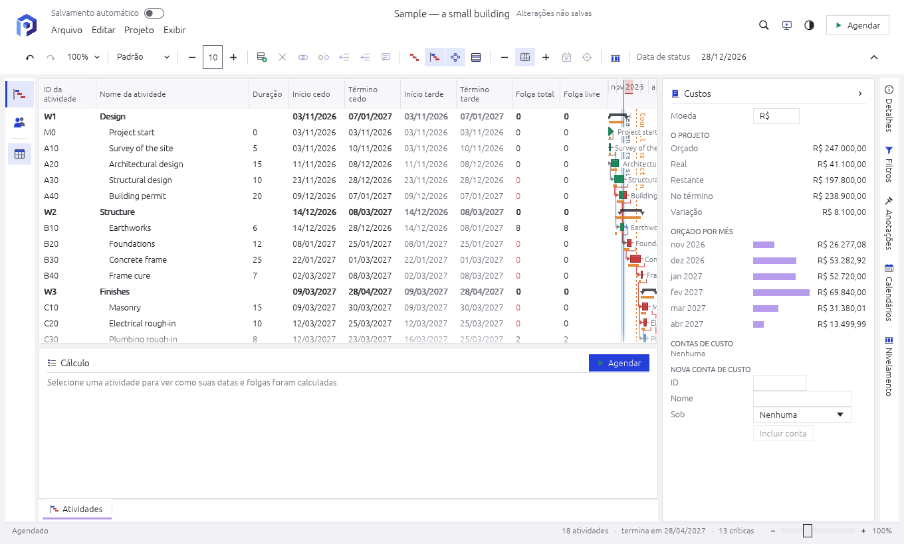
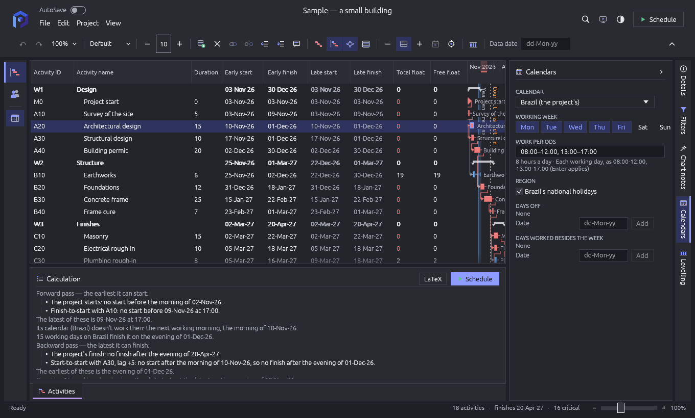
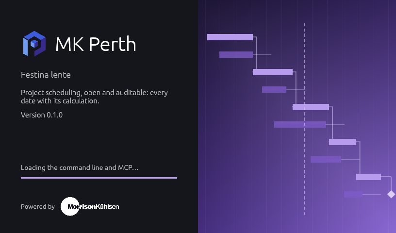

<h1 align="center">MK Perth</h1>

<p align="center">
  <b>Project scheduling, open and auditable: an open-source, clean-room project scheduler in pure Rust.</b>
</p>

<p align="center">
  Activities and WBS, the four kinds of relationship with lags, constraints, calendars,
  resources and levelling, baselines and earned value — the capabilities of enterprise
  schedulers such as Primavera P6, with every date shown with the pass that produced it. It runs
  natively on Linux, Windows and macOS, and its scheduler builds for WebAssembly.
</p>

<p align="center">
  <a href="https://github.com/morrisonkuhlsen/mkperth/actions/workflows/ci.yml"></a>
  
  
  
  <br>
  
  
  
  
  
  
</p>

<br>

<p align="center">
  <b><a href="https://morrisonkuhlsen.github.io/mkperth/">Try it in your browser</a></b> — the whole app as WebAssembly; your files never leave the page.
</p>

<p align="center">
  <a href="#why-mk-perth">Why MK Perth</a> ·
  <a href="#what-it-does-today">What it does today</a> ·
  <a href="#roadmap">Roadmap</a> ·
  <a href="#quick-start">Quick start</a> ·
  <a href="#perthjl">Perth.jl</a> ·
  <a href="#architecture">Architecture</a> ·
  <a href="#contributing">Contributing</a> ·
  <a href="#license-and-credits">License and credits</a>
</p>

<p align="center">
  
  <br><sub><b>The Activities window.</b> The table beside the Gantt chart, the critical path in red; under it, the selected activity's dates worked out step by step.</sub>
</p>

<table>
<tr>
<td width="50%" valign="top"><p align="center"><sub><b>Earned value, in dark mode.</b> BAC, PV, EV and AC; CPI, SPI, ETC, EAC, VAC and TCPI; the S-curve and the financial periods.</sub></p></td>
<td width="50%" valign="top"><p align="center"><sub><b>Resources.</b> Prices over time, assignments, and the work by week against capacity, over-allocation in red.</sub></p></td>
</tr>
<tr>
<td width="50%" valign="top"><p align="center"><sub><b>Costs, in Português (Brasil).</b> The project's costs and its spending month by month.</sub></p></td>
<td width="50%" valign="top"><p align="center"><sub><b>Calendars.</b> Working weeks, work periods, national holidays and exceptions; each date's calculation says which calendar placed it.</sub></p></td>
</tr>
</table>

<p align="center">
  
</p>

## Why MK Perth

- **Every date with its calculation.** A schedule is only as good as the trust in its dates.
  MK Perth's scheduler is small, documented rule by rule, and each rule lands with networks
  scheduled by hand; any activity's dates are shown step by step (the bounds of each pass, the
  one that wins, the calendar's placing, the floats), and exported to LaTeX.
- **Parity measured, not claimed.** The scheduling options of enterprise tools are listed one by
  one in [`docs/scheduling-parity.md`](docs/scheduling-parity.md), each marked done or next.
  Where Perth.jl schedules the same network, its dates are the reference.
- **Clean-room and open.** Behaviour comes from the scheduling literature and public
  documentation, never from another product's code or files. Licensed MIT OR Apache-2.0.
- **Never crash.** No panics and no `unsafe` in non-test code. Loops of relationships, calendars
  with no working day, absurd durations and hostile files are catalogued errors.

## What it does today

- **The critical path method:** finish-to-start, start-to-start, finish-to-finish and
  start-to-finish relationships with lags and leads; the forward and backward pass; total and
  free float (finish, start or the smaller); critical at a float threshold or on the longest
  path; durations and lags in hours on calendars with work periods.
- **Calendars:** worked weekdays, work periods, Brazil's national holidays, days off and days
  worked, exception days with hours of their own; a calendar per activity and for lags.
- **Milestones, constraints and the WBS:** start and finish milestones; start or finish on, on or
  after, on or before, mandatory, as late as possible, a secondary constraint, a must-finish-by
  date; summaries that roll up their children.
- **Progress:** a data date, actual dates, work left and expected finishes, retained logic or
  progress override; baselines with their bars and variance columns.
- **Resources:** labour, equipment and materials with prices over time, roles, assignments,
  duration types, resource-dependent activities, work by week against capacity, and levelling.
- **Costs and earned value:** expenses and cost accounts; budgeted, actual, remaining and
  at-completion costs; the project's and the WBS's budgets with their change log, spending plan
  and funding; earned value by six techniques, its indices and estimates, financial periods and
  the S-curve. PERT's three estimates as an analysis.
- **The network view:** the precedence diagram beside the Gantt chart, the critical path in red.
- **Every date with its calculation:** the selected activity's dates step by step, exported to
  LaTeX.
- **Files:** Perth.jl's projects, read and written back byte for byte; Primavera P6 XML and
  Microsoft Project XML, read and written (calendars, WBS, activities, relationships with their
  lags, constraints, progress, resources and assignments; in P6 XML also baselines, costs,
  budgets, earned value, codes, the EPS and OBS).
- **One engine, every way in:** the window, the command line (`mkperth-cli`) and an MCP server
  for agents (`mkperth-mcp`) run the same commands, each with undo; English and Português
  (Brasil), light and dark.

## Roadmap

| Milestone | What | Issues |
|-----------|------|--------|
| M0 the scheduler | durations in hours, float options, every date explained | #2, #3, #4, #5 |
| M1 data in and out | holidays of business calendars, P6 XML, Microsoft Project XML, XER (a decision) | #29, #8, #9, #10 |
| M2 the engine | commands and undo, the command line, the MCP server, the Perth.jl bridge | #12, #13, #14, #15 |
| M3 the interface | the Activities window (table and Gantt), the network view, the brand | #16, #17, #18 |
| M4 resources | resources and roles, levelling | #20, #21 |
| M5 costs | costs, budgets, earned value | #23, #24, #25 |
| Beyond | progress, baselines, codes and EPS, billing, the web app | #19, #22, #26, #27, #28 |

The plan and the progress log: [`docs/roadmap.md`](docs/roadmap.md).

## Quick start

```sh
cargo run --release -p mkperth                         # the window, with the sample project
cargo run --release -p mkperth -- project.json         # a Perth.jl project
cargo run -p mkperth-cli -- schedule --in project.json --format csv     # the schedule for scripts
cargo run -p mkperth-cli -- run --in p.xml --cmd 'activity.add={"name": "Survey"}' --out p.xml
cargo run -p mkperth-cli -- explain --in project.json --activity A100 --tex a100.tex
claude mcp add mkperth -- /path/to/mkperth-mcp        # agents open, schedule, explain and edit projects
cargo xtask ci                                         # fmt, clippy, tests, assets, layers, panics, wasm
```

Offscreen screenshots, with no window and nothing captured from the desktop:

```sh
cargo run -p mkperth-ui-egui --example snapshot -- [--in project.json] [--dark] [--lang pt-BR] out.png
```

The wasm gate needs the target once: `rustup target add wasm32-unknown-unknown`.

The whole app in a browser, in `target/web` (serve the folder, e.g. `python3 -m http.server`):

```sh
cargo install wasm-bindgen-cli --version 0.2.129   # once, at Cargo.lock's version
cargo xtask web
```

## Perth.jl

[Perth.jl](https://github.com/dantebertuzzi/Perth.jl) is the Julia package MK Perth grew from. It
is a sibling, never a dependency: MK Perth reads and writes its project JSON without loss, and its
scheduler is the oracle for the networks both express — 43 of them, ten drawn by hand and the
rest random, eight on the Brazil calendar, agree on every date and float (`crates/perth/tests/oracle.rs`).

## Architecture

An engine-first Cargo workspace with enforced layering (`cargo xtask layers`):

| Layer | Crates |
|-------|--------|
| L0    | `i18n` (message catalogs) · `core` (dates, calendars, the project) |
| L1    | `sched` (the critical path method) · `perth` (Perth.jl's JSON) · `p6xml` (Primavera P6's XML) · `mspxml` (Microsoft Project's XML) |
| L2    | `engine` (the session and its commands) |
| L3    | `ui-egui` (the Activities window) |
| L4    | `apps/mkperth` (desktop) · `apps/mkperth-cli` (command line) · `apps/mkperth-mcp` (MCP server) |

More in [`docs/architecture.md`](docs/architecture.md).

## Contributing

- **Start here:** [`CONTRIBUTING.md`](CONTRIBUTING.md); the full rules for people and agents
  (clean-room, asset policy, never-crash, quality gates) are in [`AGENTS.md`](AGENTS.md)
- **Where things stand:** [`docs/roadmap.md`](docs/roadmap.md); what changed: [`CHANGELOG.md`](CHANGELOG.md)
- **Issues:** bugs and feature requests on GitHub, with `priority:` labels; security problems
  privately, as [`SECURITY.md`](SECURITY.md) says

## License and credits

MK Perth is dual-licensed under [MIT](LICENSE-MIT) or [Apache-2.0](LICENSE-APACHE), at your option.
All artwork is original or openly licensed (see [`ATTRIBUTION.md`](ATTRIBUTION.md)), as
[`NOTICE`](NOTICE) says. Primavera P6 is a trademark of Oracle; MK Perth is not affiliated with it.

A Morrison Kühlsen project.
